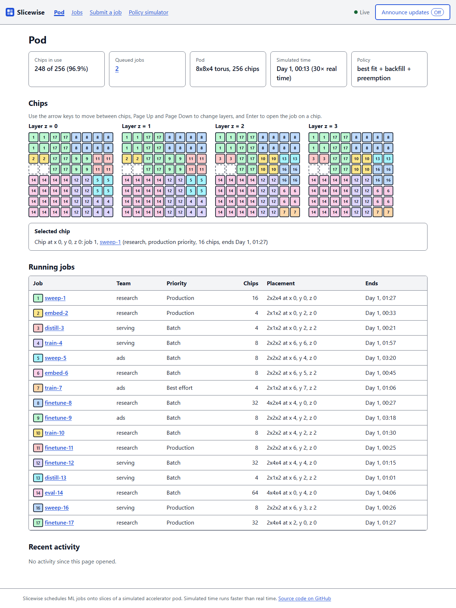
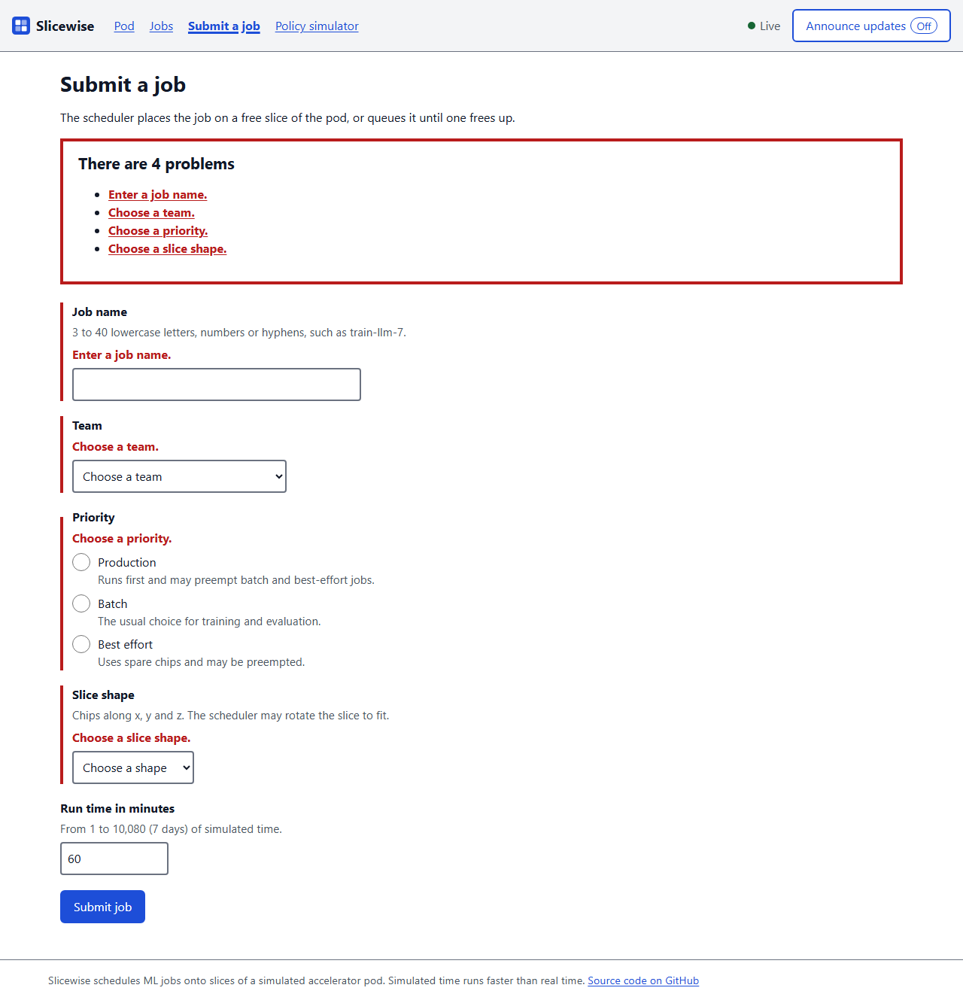
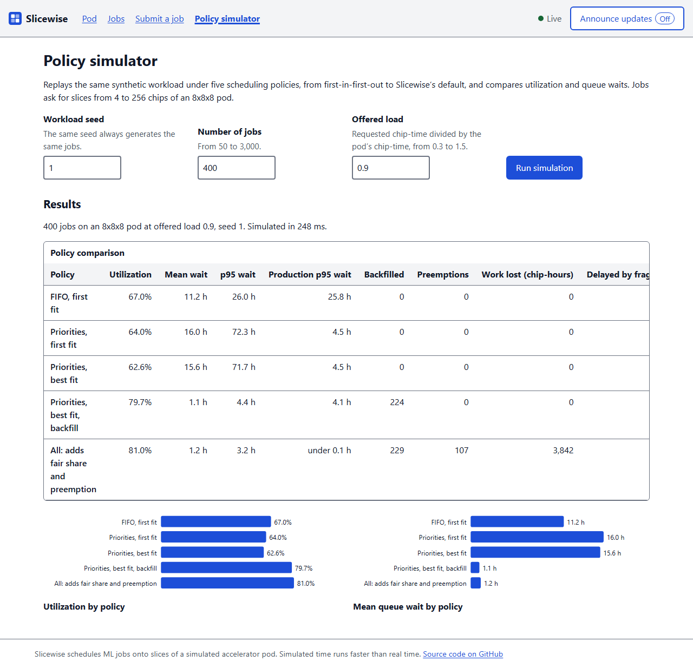
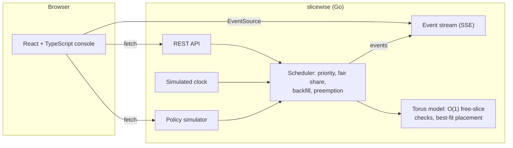

# Slicewise

[](https://github.com/yasaswinivardhireddy-png/slicewise/actions/workflows/ci.yml)

A topology-aware scheduler and an accessible web console for ML accelerator pods. The back end is Go
(standard library only); the console is React and TypeScript, built to WCAG 2.2 AA.

Training jobs on accelerator pods (such as TPU pods) need a *slice*: a contiguous block of chips on
the pod's 3D torus interconnect, for example 4x4x4 chips. Slicewise schedules jobs onto slices with
priorities, per-team fair share, best-fit placement, EASY backfilling and preemption, and serves a
console where people submit jobs, watch the pod and compare scheduling policies. Every part of the
console works with a keyboard and a screen reader, and it is tested for that in CI.



## Results

**Scheduling.** `slicewise simulate` replays the same synthetic workloads under five policies:
5 workloads of 2,000 jobs on a 512-chip (8x8x8) pod at an offered load of 0.9. Jobs ask for 4- to
256-chip slices and run from 15 minutes to 8 hours. The simulation is deterministic (seeded), so CI
reproduces this table exactly; see the job summary of a [CI run](https://github.com/yasaswinivardhireddy-png/slicewise/actions/workflows/ci.yml).

| Policy | Utilization | Mean wait | p95 wait | Production p95 wait | Backfilled | Preemptions | Work lost to preemption | Jobs delayed by fragmentation |
|---|---:|---:|---:|---:|---:|---:|---:|---:|
| FIFO, first fit | 65.7% | 55.8 h | 104.2 h | 104.5 h | 0 | 0 | 0 chip-hours | 312 |
| Priorities, first fit | 65.0% | 59.0 h | 259.7 h | 2.3 h | 0 | 0 | 0 chip-hours | 295 |
| Priorities, best fit | 66.9% | 54.3 h | 245.3 h | 2.3 h | 0 | 0 | 0 chip-hours | 231 |
| Priorities, best fit, backfill | 82.8% | 2.2 h | 7.5 h | 1.8 h | 1391 | 0 | 0 chip-hours | 82 |
| All: adds fair share and preemption | 85.9% | 2.9 h | 10.6 h | 0.0 h | 1459 | 301 | 11181 chip-hours | 84 |

- **Backfilling** is the big win: utilization rises from 66.9% to 82.8% and the mean queue wait
  drops from 54.3 h to 2.2 h, because small jobs fill the gaps that a blocked large job leaves.
- **Priorities** cut the p95 wait of production jobs from 104.5 h to 2.3 h; **preemption** cuts it
  to almost zero. That costs 301 preemptions and 11,181 chip-hours of lost work per workload,
  because jobs restart without checkpoints, and the mean wait of other jobs rises from 2.2 h to 2.9 h.
- **Best fit** (packing slices against busy chips) instead of first fit cuts the number of jobs held
  up by fragmentation, with enough free chips but no free slice of the right shape, by 22% (295 to 231).
- Utilization counts every busy chip, including work later lost to preemption.

**Accessibility.**

| Check | Result |
|---|---|
| axe-core on every page and state in a real browser (Playwright, Chromium), WCAG 2.2 A and AA rules including color contrast: 6 pages, the form with errors, the open dialog, simulator results, forced-colors mode, and a busy pod showing all 8 job colors | 0 violations |
| axe-core on 9 page states in jsdom (Vitest), WCAG 2.2 and best-practice rules | 0 violations |
| Keyboard only: skip link, submit a job, find its chips on the pod grid with the arrow keys, open it, cancel it through the dialog | passes, no mouse |
| Reflow at 320 CSS pixels wide (WCAG 1.4.10), 5 pages | no horizontal scrolling |
| Reduced motion and forced colors (Windows high contrast) | transitions off; focus outline kept |

**Engineering.** 36 Go tests (including a property test of the backfill guarantee over random
workloads), 3 fuzz targets and the race detector; 25 Vitest tests; 7 Playwright tests; a container
image smoke-tested in CI. Checking whether a slice is free takes constant time (see below).

## The console

| | |
|---|---|
|  |  |

How it is built for accessibility:

- **The chip map is an ARIA grid per layer** with a single tab stop. Arrow keys move between chips,
  Page Up and Page Down between layers, Home and End along a row, and Enter opens the chip's job.
  Each chip has a full label ("x 3, y 1, z 0: job 17, train-17, research, production priority"),
  and the job number is printed on it, so color is never the only cue.
- **Live updates do not flood screen readers.** Changes stream over Server-Sent Events and the
  page updates at once, but announcements of background activity are opt-in ("Announce updates")
  and summarized at most every 10 seconds ("Update: 3 jobs started and 1 job finished."). Results
  of the user's own actions (submitted, cancelled, sorted, filtered) are always announced.
- **Focus is managed.** After client-side navigation focus moves to the new page's heading; a
  failed submit moves it to an error summary whose links jump to each field; the cancel dialog is a
  native modal `<dialog>` that traps focus and returns it, and focus moves to the heading once the
  cancelled job's button disappears (a bug the keyboard test caught).
- **Forms follow the GOV.UK pattern:** visible labels and hints, inline errors connected with
  `aria-describedby` and `aria-invalid`, and the same messages for client and server validation.
- **Tables and charts:** sortable columns expose `aria-sort`; tables scroll inside a focusable
  region instead of the page; every chart is an SVG image with a title and a one-sentence summary,
  values printed on the bars, and the full data in a table.
- **Visual design:** text contrast of at least 4.5:1 and UI contrast of at least 3:1 in light and
  dark themes, a 3-pixel focus ring, targets of at least 24 pixels, support for forced colors and
  reduced motion, and layouts that reflow down to 320 pixels.

## How the scheduler works



- **Free-slice checks in constant time.** The torus wraps around every axis, so a slice may cross
  an edge. [`topo`](internal/topo) keeps 3D prefix sums over the pod tiled twice along each axis;
  any slice, wrapped or not, is then a contiguous range, and counting its busy chips takes 8 lookups.
  Placement scans every distinct position and rotation (each side spanning a whole axis is placed
  once), so a search is linear in the pod size. Tests check the counts against brute force.
- **Best fit** scores each free position by how many busy chips touch the slice's faces, also in
  constant time, and packs slices together so that free chips stay in large blocks.
- **Ordering.** The queue is sorted by priority, then by fair share (a team's chips in use divided
  by its quota), then by arrival.
- **EASY backfilling.** When the job at the head of the queue does not fit, the scheduler finds the
  earliest time and the slice it can have once running jobs end, and reserves them. Later jobs may
  start now only if they end before the reservation or stay out of the reserved slice, so they can
  never delay it. A property test checks this guarantee on random workloads.
- **Preemption.** A blocked job may evict lower-priority jobs. Among the slices it could free, the
  scheduler picks the one whose victims lose the least work (chips times time since they started).
- The API reports each queued job's position and reservation, and the console shows them.

## API

| Method and path | Purpose |
|---|---|
| `GET /api/v1/pod` | Pod dimensions, the job on every chip, running jobs, simulated time |
| `GET /api/v1/jobs?state=&tenant=` | Jobs, newest first (`state`: queued, running, finished or all) |
| `POST /api/v1/jobs` | Submit `{name, tenant, priority, shape, durationMinutes}`; field errors come back as an RFC 9457 problem with an `errors` object |
| `GET /api/v1/jobs/{id}` | A job with its history, queue position and reservation |
| `POST /api/v1/jobs/{id}/cancel` | Cancel a queued or running job |
| `GET /api/v1/tenants` | Teams, quotas and usage |
| `GET /api/v1/events` | Server-Sent Events; reconnecting with `Last-Event-ID` replays missed events |
| `POST /api/v1/simulations` | Compare the five policies on a generated workload `{seed, jobs, load}` |
| `GET /metrics` | Prometheus metrics |

The server sets a strict Content-Security-Policy (`script-src 'self'`, no inline scripts), limits
request bodies to 16 KB and rejects unknown JSON fields.

## Run it

With Docker:

```sh
docker build -t slicewise .
docker run -p 8080:8080 slicewise    # open http://localhost:8080
```

From source (Go 1.27 and Node.js 24):

```sh
cd web && npm ci && npm run build && cd ..
cp -r web/dist/. internal/webui/dist/
go run ./cmd/slicewise                # console and API on http://127.0.0.1:8080, demo workload on
go run ./cmd/slicewise simulate       # print the policy comparison
```

For console development, run `go run ./cmd/slicewise` and `npm run dev` in `web/`; Vite proxies
`/api` to the server. Tests: `go test -race ./...`, and in `web/`, `npm test` and `npx playwright test`
(after building the server binary at the repository root).

## Layout

| Path | Contents |
|---|---|
| [`internal/topo`](internal/topo) | Torus model: shapes, rotations, prefix-sum counters, placement |
| [`internal/sched`](internal/sched) | Scheduler: ordering, backfilling, preemption, invariants |
| [`internal/sim`](internal/sim) | Workload generator, policy comparison |
| [`internal/server`](internal/server) | HTTP API, event stream, metrics, demo workload |
| [`web/src`](web/src) | Console: pages, the chip grid, live announcements |
| [`web/e2e`](web/e2e) | Playwright tests with axe |

## Limitations

- It is a simulation. Nothing runs on real accelerators, and a job's run time is known exactly when
  it is submitted; real schedulers work with inaccurate estimates.
- State is in memory in one process, with no authentication, so it is a demonstration rather than a
  production service.
- Preemption restarts a job from scratch; with checkpointing it would lose much less work.
- Automated checks and keyboard tests find many accessibility problems but not all of them. The
  console has not yet been tested with screen reader users.
- Inspired by TPU-style pods; not affiliated with Google.

## License

MIT
